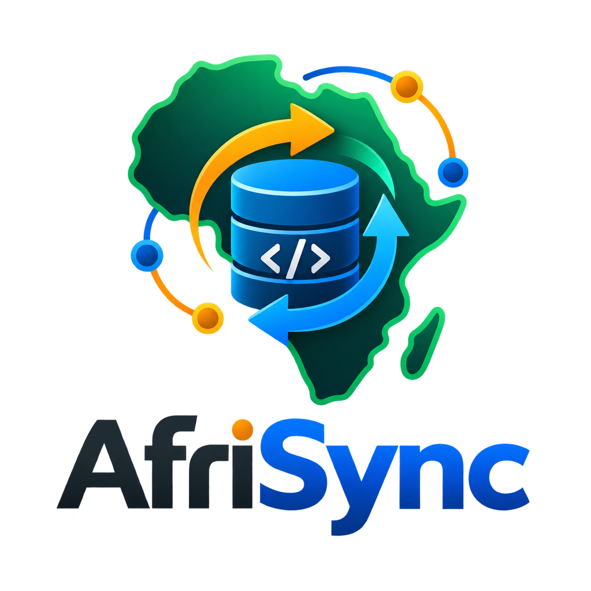

  

AfriSync

Build Together. Stay in Sync.

AfriSync is an offline-first project synchronization platform built for developers, teams, researchers, and builders working in environments where internet access is not always reliable.

  
  
  
  
  
  
  
  

Why AfriSync exists

AfriSync was created from a research interest in one of the practical problems affecting technology, productivity, and digital collaboration across many African contexts: unstable connectivity.

Across the continent, many developers, students, researchers, SMEs, field teams, and institutions are expected to work with digital tools that assume constant internet access. But real working conditions often include unstable networks, expensive data, power interruptions, rural connectivity gaps, and fragmented team collaboration.

AfriSync is an attempt to answer one question:

What would a collaboration and project-management tool look like if it was designed from the beginning for African infrastructure realities, not copied from environments where internet access is always assumed?

This project treats offline access not as a backup feature, but as a core design principle.

The core idea

Most web apps follow this logic:

User action → internet required → server saves data

AfriSync follows a different logic:

User action → local device saves first → syncs later when internet is available

That means users can still create projects, write notes, manage records, prepare updates, and continue work even when they are offline. When the connection returns, AfriSync synchronizes changes across devices and teams.

Why the name “AfriSync”

The name combines two ideas:

Afri → Africa, African builders, African realities, African problem-solving
Sync → synchronization, collaboration, continuity, data flow, teamwork

AfriSync means:

Africa in sync — people, projects, data, and teams working together even when infrastructure is imperfect.

Logo meaning

The AfriSync logo represents the identity of the project:

Logo element

Meaning

Africa outline

The project is built from African realities and for African problem-solving.

Database cylinder

AfriSync protects project data, notes, attachments, users, logs, and sync records.

Code symbol </>

The project is developer-centered and open for builders to improve.

Circular arrows

Offline-first synchronization across devices, users, and teams.

Connected nodes

Collaboration across borders, communities, and development teams.

Colour meaning

Colour

Meaning

Deep emerald / green

Africa, resilience, growth, infrastructure, and continuity.

Electric blue / cyan

Technology, synchronization, cloud/data flow, and modern software systems.

Amber / orange

Energy, innovation, alerts, progress, and African sunlight.

Charcoal / slate

Professionalism, serious engineering, security, and developer focus.

White / soft neutral

Clarity, readability, simplicity, and clean product design.

What AfriSync does today

AfriSync currently includes:

Offline-first local project management

Remote synchronization server

Multi-device sync simulation

Device A and Device B local environments

Project creation, editing, deletion, and restoration

Notes attached to projects

File attachments

Team invitations

Viewer and Editor roles

Role changes between Viewer and Editor

Editor permission for project updates where allowed

Sync history

Activity logs

Notifications

Conflict tracking

Error center

Password reset

Email verification with 4-digit code

Google sign-in support

Admin dashboard

Admin actions for users, projects, roles, and ownership

PostgreSQL-ready production migration layer

Deployment preparation files

Desktop launcher packaging support

Responsive browser access for desktop, tablet, and phone

Architecture

AfriSync is built as an offline-first system:

Local Device A
   ↓
Local SQLite database
   ↓
Remote FastAPI sync server
   ↓
Server database: SQLite now, PostgreSQL-ready for production
   ↓
Local Device B

The system is designed so local devices can continue working first, then synchronize with the server later.

Main project structure

afrisync/
├── app/
│   ├── database.py
│   └── sync_engine.py
│
├── templates/
│   └── dashboard.html
│
├── assets/
│   └── afrisync_connected_africa_logo.png
│
├── server.py
├── local_app.py
├── admin_app.py
├── background_sync.py
├── pull_sync.py
├── network.py
│
├── run_remote_server.ps1
├── run_device_a.ps1
├── run_device_b.ps1
├── run_admin_dashboard.ps1
│
├── README.md
├── SETUP_AND_RUN.md
├── PROJECT_STATUS.md
└── MOBILE_APP_CONVERSION_PLAN.md

Open-source vision

AfriSync is being pushed to GitHub as an open-source project because the problem it addresses is bigger than one developer.

The spirit behind this project is similar to the open-source culture that allowed projects like Linux to grow through public collaboration: one person starts with a working idea, then other developers inspect it, improve it, adapt it, and build on it for wider benefit.

AfriSync is open for developers who want to contribute to tools designed for African realities, including:

offline-first software

synchronization systems

developer tools

civic technology

education technology

SME productivity tools

field-data systems

local-first infrastructure

African technology research

The goal is not only to build an app, but to create a useful open-source foundation for people who believe African software should be designed with African constraints in mind.

Who this project can help

AfriSync can support:

developers working with unstable internet

student developer teams

research teams collecting notes and files

small organizations managing field projects

African SMEs working across locations

civic-tech and non-profit teams

local-first software researchers

teams building internal project tools

Roadmap

The current web version is the foundation. The next major direction is to convert AfriSync into a true Android/iOS mobile app.

Planned next stages:

Improve final UI/UX design system

Stabilize all core web features

Push project to GitHub

Invite open-source collaborators

Build afrisync-mobile with Expo React Native

Reuse the current FastAPI backend

Add mobile SQLite offline storage

Add mobile file attachment support

Add mobile sync queue

Prepare Android build first, then iOS

Collaboration invitation

This project is open to developers, designers, technical writers, backend engineers, mobile developers, product thinkers, and researchers who want to help build practical software for African conditions.

Areas where collaborators can help:

React Native mobile app development

UI/UX design polish

PostgreSQL production migration

conflict-resolution algorithms

offline-first architecture

automated testing

documentation

deployment

security review

accessibility

product strategy

If you believe technology for Africa should be built with infrastructure realities in mind, this project welcomes your contribution.

Maintainer

Wahab Opeyemi Badmus
Researcher, software developer, and AI governance enthusiast working at the intersection of African development, technology, research, and practical software systems.

GitHub: abdulwahabbadmus001-creator

Setup

For installation and local testing, read:

SETUP_AND_RUN.md

For current status and roadmap, read:

PROJECT_STATUS.md

For mobile conversion planning, read:

MOBILE_APP_CONVERSION_PLAN.md

License

This project is intended to be open source for public learning, collaboration, and African technology development. Add a formal license file before accepting external contributions.